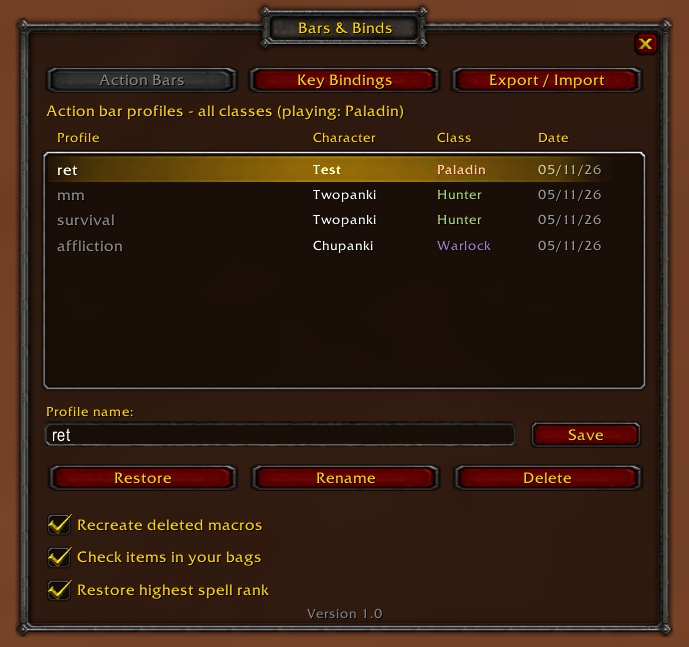
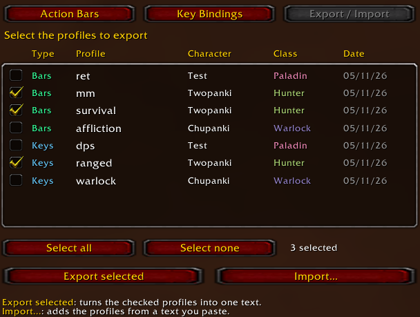
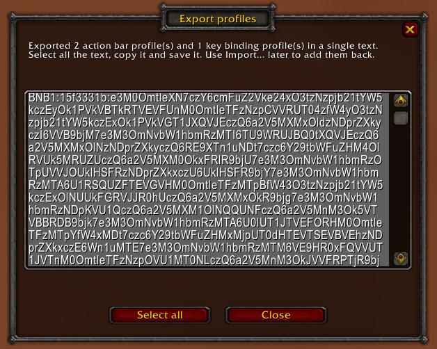

# Bars & Binds

**Save, restore, export and import your action bars and key bindings, all from one window.**

Bars & Binds is a World of Warcraft addon for **WotLK 3.3.5a** (Interface 30300) to manage your action bar and key binding profiles.

## Features

- Save and restore **action bar profiles**.
- Save and restore **key binding profiles**.
- One window for everything, opened with `/bnb`.
- See every saved profile at a glance: character, class (class colored) and date.
- **Export** any selection of profiles into a single text string and **import** it later or on another account.
- Restores spells by **spell ID**, so profiles still work if the client language changes.

## Usage

Type `/bnb` to open the main window. It has three tabs.

### Action Bars

Lists the action bar profiles of **all classes** saved on your account. Profiles from other classes appear greyed out: you can rename, delete or export them, but they can only be restored by a character of that class.

- **Save**: type a name in *Profile name* and click *Save* (or press Enter). If the name already exists you are asked before overwriting it.
- **Restore**: select a profile and click *Restore*. Not available while in combat.
- **Rename / Delete**: act on the selected profile.

Options at the bottom of the tab (all enabled by default):

| Option | What it does |
|---|---|
| Recreate deleted macros | When restoring, macros that no longer exist are created again. |
| Check items in your bags | Only restores an item button if you actually have the item. |
| Restore highest spell rank | Uses the highest rank you know instead of the saved rank. |

If some buttons cannot be restored (spell not learned, item missing, macro deleted...), a summary is printed in chat. Type `/bnb bars errors` for details.

### Key Bindings

Same layout as the Action Bars tab. Key binding profiles are **account wide** and can be restored by **any character**.

> Restoring a key binding profile replaces your current key bindings with the saved ones.

### Export / Import

1. Tick the profiles you want (action bars and key bindings can be mixed), or use *Select all* / *Select none*.
2. Click **Export selected**.
3. In the window that opens, click *Select all*, copy the text and save it somewhere safe.

To bring profiles back, click **Import...**, paste the text and click *Import*. If some of the profiles already exist you will be asked before they are overwritten.

## Chat commands - Optional for extra features

| Command | Description |
|---|---|
| `/bnb` | Opens or closes the main window. |
| `/bnb bars` | Shows the action bar commands. |
| `/bnb keys` | Shows the key binding commands. |

### `/bnb bars`

| Command | Description |
|---|---|
| `/bnb bars save <profile>` | Saves your current action bars. |
| `/bnb bars restore <profile>` | Restores a profile. |
| `/bnb bars delete <profile>` | Deletes a profile. |
| `/bnb bars rename <old> <new>` | Renames a profile. |
| `/bnb bars list` | Lists saved profiles, grouped by class. |
| `/bnb bars errors` | Shows the errors of the last restore. |
| `/bnb bars link "<spell 1>" "<spell 2>"` | Links two spells: if one cannot be found, the other is used. Quotes are required. |
| `/bnb bars macro` | Toggles recreating deleted macros. |
| `/bnb bars count` | Toggles checking items in your bags. |
| `/bnb bars rank` | Toggles restoring the highest spell rank. |

### `/bnb keys`

| Command | Description |
|---|---|
| `/bnb keys save <profile>` | Saves your current key bindings. |
| `/bnb keys restore <profile>` | Restores a profile. |
| `/bnb keys delete <profile>` | Deletes a profile. |
| `/bnb keys rename <old> <new>` | Renames a profile. |
| `/bnb keys list` | Lists your key binding profiles. |
| `/bnb keys clear` | Deletes **all** saved key binding profiles. |

## Good to know

- Profiles are stored in the `BarsAndBindsDB` saved variable, shared by all characters on the account.
- Restoring is not possible while in combat.

## Credits

- **Chupanki**: author of Bars & Binds.
- **Shadowed**: [Action Bar Saver](https://www.curseforge.com/wow/addons/action-bar-saver), the base of the action bar profiles.
- **zimeng**: Key Bindings Profiler, the base of the key binding profiles.
